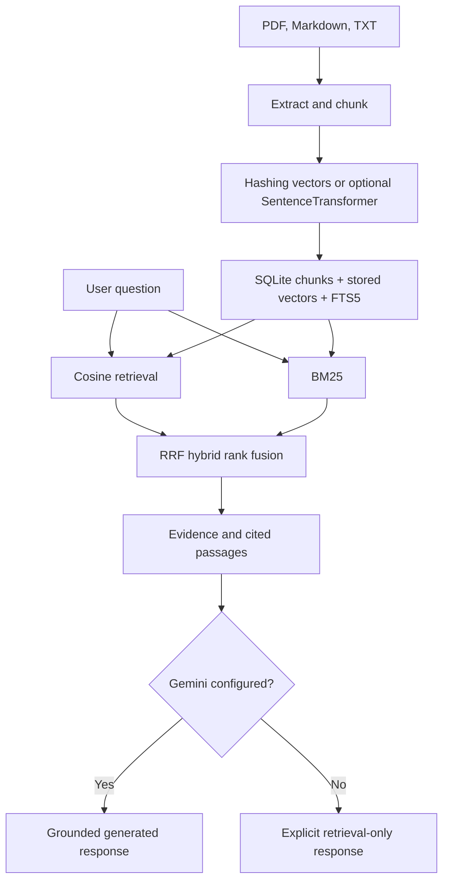

# DocPilot — Document-Grounded RAG Knowledge Assistant

DocPilot is a **FastAPI + hybrid-search Retrieval-Augmented Generation (RAG)** prototype. Upload PDF, Markdown, and text documents, retrieve cited evidence, and optionally generate grounded answers with Gemini.

> **Project status:** Local, reproducible portfolio prototype. Not a production multi-tenant SaaS. The default offline vectorizer is lexical hashing; transformer-based semantic embeddings are optional.

## Features

- PDF / TXT / Markdown ingestion, overlapping chunks, SQLite persistence and FTS5 indexing
- Vector cosine retrieval + BM25 lexical retrieval, combined using reciprocal rank fusion (RRF)
- Optional `sentence-transformers/all-MiniLM-L6-v2` embeddings
- Optional Gemini answer generation; evidence citation metadata and abstention when no evidence is found
- Retrieval evaluation with Hit@1/3/5 and MRR@5
- Web interface and FastAPI endpoints; Docker, Pytest and GitHub Actions CI configuration

## Architecture



## Local setup

Requirements: Python 3.11+.

```bash
python -m venv .venv
# Linux/macOS:
source .venv/bin/activate
# Windows PowerShell:
# .venv\Scripts\Activate.ps1
pip install -r requirements-dev.txt
cp .env.example .env
uvicorn docpilot.api:app --reload --env-file .env
```

Open **http://localhost:8000** for the dashboard and **http://localhost:8000/docs** for Swagger documentation.

For transformer embeddings: `pip install -r requirements-semantic.txt`; set `EMBEDDING_BACKEND=sentence_transformers`. Reindex the documents after switching embedding backends. For generated answers, set your own `GEMINI_API_KEY`. Never commit secrets.

## API examples

```bash
curl -X POST http://localhost:8000/api/demo/seed
curl -F 'file=@example.pdf' http://localhost:8000/api/documents
curl -X POST http://localhost:8000/api/ask -H 'Content-Type: application/json' -d '{"question":"What does the policy say?","top_k":4}'
curl http://localhost:8000/api/evaluation
```

## Testing

```bash
pip install -r requirements-dev.txt
pytest -q
```

Eight offline tests cover parsing, chunking, persistence, hybrid ranking, citation structure and API/evaluation behavior. External Gemini calls and transformer inference are not included in the offline suite.

## Security and limitations

This is **not a production deployment**. It has no authentication, tenant isolation, malware scanning, scalable approximate-nearest-neighbor index or comprehensive prompt-injection protection. Do not upload confidential information. Retrieved document content is untrusted and generated responses must be checked against citations.

## Maintainer

[Consoder](https://github.com/Consoder)
